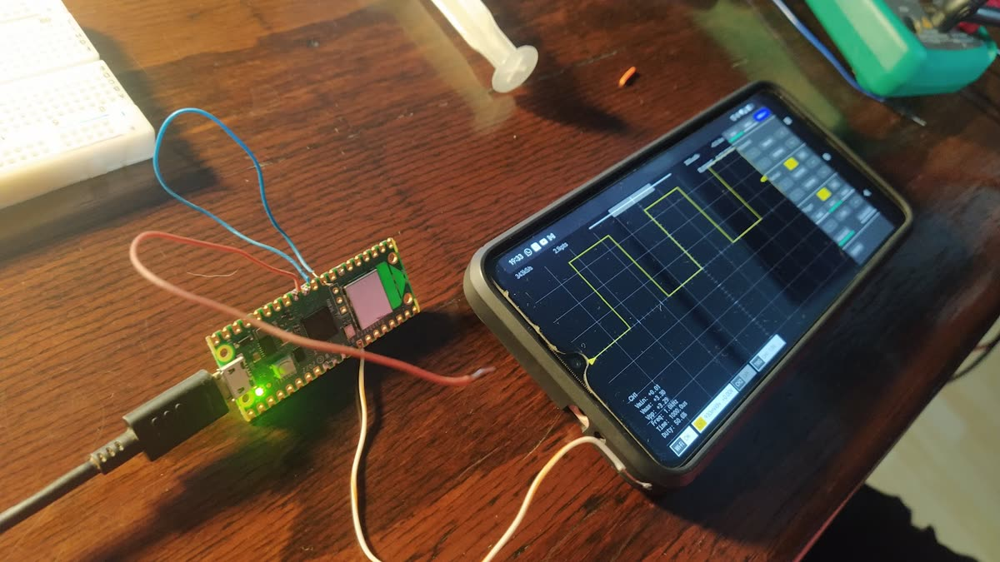
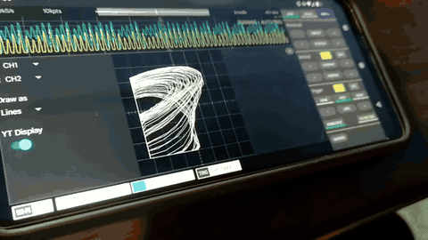
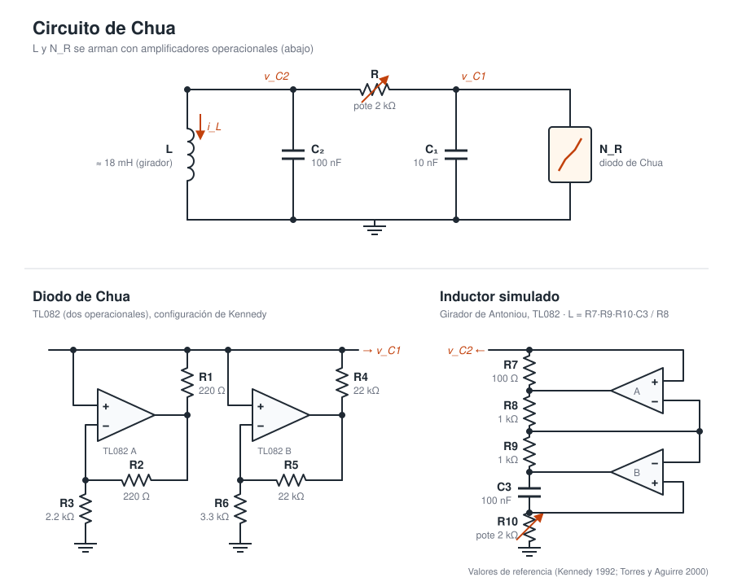

# Circuito de Chua

Proyecto de Laboratorio 3 (UBA). Armamos un circuito de Chua y después hice mas cosas.

## Qué hice

- Armamos el circuito de Chua en el labo y barrimos la inductancia L para ver la ruta al caos
- Medimos la curva I–V del diodo de Chua y saqué las pendientes y los quiebres (`python/diodo_chua/`)
- Derivé las ecuaciones del circuito (`notas/derivacion_ecuaciones.md`)
- Lo simulé en Julia con DifferentialEquations.jl usando los valores reales de los componentes
- Rehice los barridos en Python con JAX + diffrax para ver si era más rápido que Cython [resultado: gano JAX]
- Suavicé el diodo (que es lineal a trozos) con una aproximación log-cosh para que el solver no sufra
- Hice el diagrama de bifurcación en función de L, animado junto con el retrato de fase
- Animé el atractor y la sensibilidad a condiciones iniciales con Manim

## Osciloscopio casero

- Como no tenía osciloscopio en casa, armé uno con una Raspberry Pi Pico y una app en el celular
- Funcionó: una cuadrada de 1 kHz se ve perfecta, y en modo XY se ve el atractor
- El ADC de la Pico solo lee de 0 a 3.3 V, así que la parte negativa se recorta (por eso el atractor tiene una "pared")
- Para la próxima: un divisor resistivo con offset para correr la señal al rango del ADC

  
  

## El circuito

## Carpetas

- `julia/`: simulación y bifurcación en Julia
- `python/bifurcacion/`: barridos con JAX + diffrax
- `python/manim/`: animaciones
- `python/diodo_chua/`: medición del diodo
- `notas/`: derivación de las ecuaciones
- `presentacion/`: diapositivas
