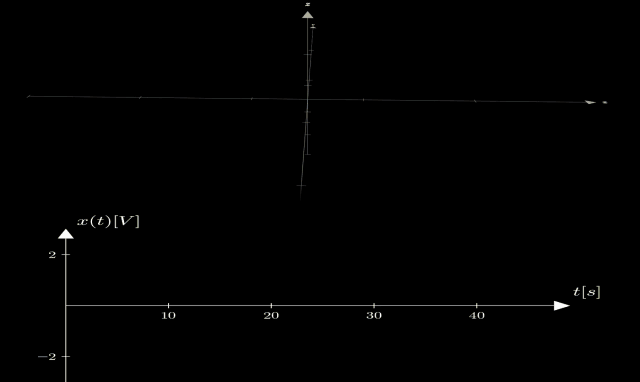
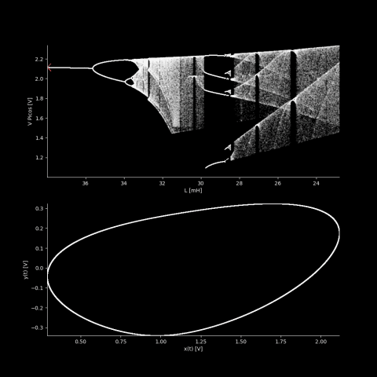
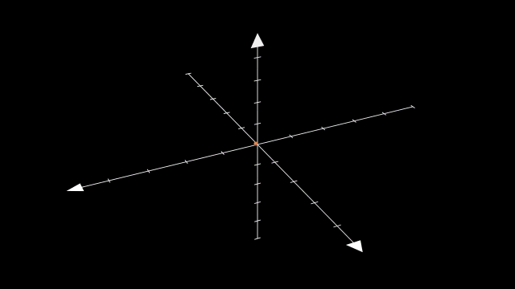

# Circuito de Chua

Proyecto de Laboratorio 3: caos en el circuito de Chua. Simulación, diagramas de bifurcación y animaciones.

## Contenido

- `julia/`: simulación del circuito con los valores reales de los componentes (DifferentialEquations.jl) y diagrama de bifurcación.
- `python/bifurcacion/`: barridos de parámetros con JAX + diffrax y animación del diagrama de bifurcación.
- `python/manim/`: animaciones del atractor en Manim.
- `python/diodo_chua/`: medición de la curva característica del diodo de Chua.
- `notas/`: derivación de las ecuaciones.
- `presentacion/`: diapositivas.
